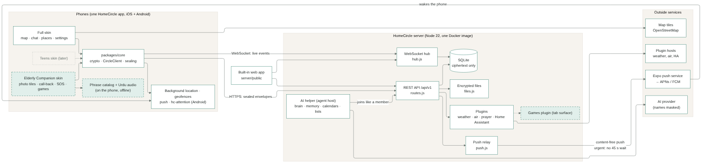
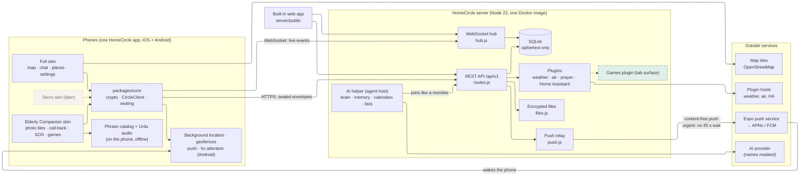
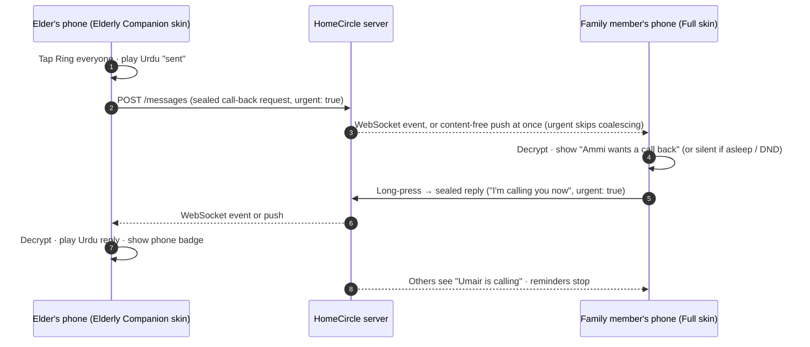

# HomeCircle architecture (developer docs)

| | |
|---|---|
| **Doc version** | 1.4 |
| **Updated** | 2026-10-28 |
| **Describes** | HomeCircle 0.21.0 as built, including the Elderly Companion skin and its settings, the call-back loop, urgent delivery, the phrase catalog, family names and photos; plus the planned Games plugin, asleep detection and inactivity check-ins (marked *planned*) |
| **Source of truth for planned features** | `PRD.md` and the handoff kickoff. Where this doc and the PRD disagree, the PRD wins. |

HomeCircle is a self-hosted, end-to-end encrypted family app: a live family map, Locate, place arrival alerts, family chat, an AI helper and optional plugins. One server hosts many isolated **circles**. Phones encrypt everything before upload; the server stores and relays ciphertext it cannot read.

Planned parts are marked **planned**: they come from the PRD and their exact design is decided in Claude Code's plan, which updates this doc.

## 0. Principles: the server stays secure, encrypted and fast

These come first. A feature that can't meet them is redesigned, not shipped.

1. **The server never sees content.** Every new feature uses sealed envelopes (circle key, or a pair's direct key). No feature may add plaintext names, message text, game moves, photos, settings or languages to the server, its database, its logs or push payloads.
2. **The server stays thin.** It authenticates, scopes to one circle, stores ciphertext, orders and relays. Feature logic (rules, reminders, sleep and DND checks, game rules, translations) runs on the phones. New server code needs a reason it can't live on a phone.
3. **New metadata is a cost.** The threat model in `PROTOCOL.md` lists what the server can see. A feature that adds to that list (for example an outer "urgent" flag) must say so in its plan, keep it to the minimum, and update the threat model.
4. **Delivery is fast and cheap.** Messages go out over the existing WebSocket to open apps and as one content-free, high-priority push to the rest. No polling. Payloads stay small. Every new message type is checked with the load-test swarm (`docs/LOAD-TEST.md`) before release.
5. **Signed and verified.** Everything a phone accepts is signature-checked against the sender's trusted profile; game moves and call-back replies are rejected if the signer isn't allowed to send them.
6. **Least privilege.** Plugins reach only their declared hosts; the AI helper never holds the circle key and only sees masked names; admin-only actions are enforced by signed records the phones verify, not by trusting the server.

### What these principles mean for the planned features

| Feature | Design consequence |
|---|---|
| **Call-back urgency (built, 0.20.0)** | The server coalesces chat pushes to one per member every 45 s (`push.js`, `ACTIVITY_COALESCE_MS`), and it can't tell a call-back request from a chat message, so a request could arrive up to 45 s late. Decision: messages carry an outer `urgent: true` flag that skips coalescing and is pushed at once, at high priority. It's used only for call-back requests, replies to the elder, "taken" notices and SOS. The push payload stays identical to a normal message push, so Apple, Google and Expo learn nothing new. The server learns that member X sent an urgent message at time T (never what or why); this is added to the threat model in `PROTOCOL.md`. The server rate-limits urgent messages per sender (10 a minute), and anything over the limit falls back to normal coalesced delivery, never dropped. |
| **Call-back reminders (built, 0.20.0)** | The server can't read requests, so it can't send reminders. Each family member's phone schedules its own local reminders when a request arrives and cancels them when it sees "taken". This works even if her phone goes offline and adds no server traffic. |
| **Asleep and DND (planned)** | Detected on each family member's phone, which then sends her the sealed "asleep" reply. The server never learns who is asleep. |
| **Inactivity check-in (planned)** | Family phones already see when her phone last uploaded a location (sealed, with a time). They raise the check-in locally; no new server logic. |
| **Skins (built, 0.20.0; settings 0.21.0)** | Chosen by an admin: sealed inside the elder's invite, then in the admins' `member` record about her, which the phone follows (most restricted across its circles). The server never learns who uses which skin. |
| **Elder config, family names, photos (built, 0.21.0)** | Sealed, signed records (`member`, `alias` in the records store), verified on the phones against the setter's right to set them (admin, or the person themself). Photos are encrypted files like today's uploads. |
| **Games** | Moves sealed with the pair's direct key, signed, rule-checked on both phones; races resolved by the server's existing message order. |
| **Languages and audio (built, 0.20.0; recordings are placeholders)** | The phrase catalog and recordings ship in the app; only keys and names travel, sealed. Nothing language-specific reaches the server. |

## 1. Repository layout

| Path | What it is |
|---|---|
| `packages/core/` | Shared JavaScript used by the mobile app, the built-in web app, the agent and tests: crypto (`crypto.js`, TweetNaCl), the circle client (`client.js`), the API wrapper (`api.js`), the agent client (`agent.js`), features (`features.js`), places, prayer times, emoji. |
| `server/` | Node.js 22 server. `src/http.js` and `routes.js` (REST API under `/api/v1`), `hub.js` (WebSocket relay), `db.js` (SQLite via `node:sqlite`), `push.js` (content-free push through Expo), `files.js` (encrypted uploads), `plugins/` (weather, air, prayer, Home Assistant), `agent/` (the AI helper), `public/` (the built-in web app). |
| `mobile/` | iOS and Android app, Expo / React Native with Expo Router. `src/app/` (screens and tabs; `src/app/companion/` is the Elderly Companion skin), `src/skins/` (the list of skins), `src/companion/` (her lines, status and offline queue), `src/lib/` (location, push, notifications, call-back reminders, chirps, SOS, storage), `src/map/`, `assets/phrases/` (the phrase catalog and recordings, built by `scripts/phrases.mjs`), `modules/hc-attention/` (Android-only native module: Do Not Disturb, flash, alarm sound, playing phrase recordings in sequence). |
| `homecircle/` | Home Assistant add-on packaging (`config.yaml`, changelog). |
| `landing/` | Marketing site and "choose your server" wizard (static). |
| `deploy/` | Docker Compose, Caddy, installer, cloud-init, hosting guides. |
| `docs/` | `PROTOCOL.md` (encryption and API), setup, Home Assistant, load and battery tests, and this file. |

## 2. Architecture diagram



The diagram's source is `architecture.mmd` (Mermaid). Solid boxes exist today; dashed boxes are **planned**.



(Kept in sync with `architecture.mmd`.)

## 3. Components

### packages/core
Everything that touches keys or envelopes lives here, so the mobile app, web app, agent and tests share one implementation. `CircleClient` holds a phone's identity and key ring per circle, seals and opens envelopes, keeps the WebSocket open while the app is in the foreground, and exposes chat, polls, reactions, read receipts, locations, places and the agent.

### Server
The server is deliberately thin: it authenticates devices, scopes every request to one circle, stores ciphertext, assigns message sequence numbers, relays events over WebSocket, and sends content-free pushes. It never holds a circle key.

| Module | Role |
|---|---|
| `routes.js`, `http.js` | REST API (see `PROTOCOL.md` for the full table). |
| `hub.js` | One WebSocket per open app per circle; auth in the first frame; pings every 25 s. |
| `db.js` | SQLite tables: circles, members, invites, rejoin requests, key envelopes, locations (latest only), frequent places, chirps, messages, files (helper files and members' photos), places, records (sealed member settings and family names). |
| `push.js` | Batches pushes to Expo, which forwards to APNs and FCM. Payloads carry no names, locations or text. |
| `files.js` | Stores client-encrypted uploads: files for the helper (the key in a sealed message) and members' photos (the key in a sealed profile or `member` record). |
| `plugins/` | Optional per-circle features; each declares the outside hosts it may call and gets a fetch limited to those. |
| `agent/` | The AI helper (see below). |

### AI helper (server/src/agent)
Runs next to the server when `AGENT=true`. It joins a circle like a member, through an invite sealed to the agent host, so it holds its own keys but never the circle key. `brain.js` understands requests and runs **Dream** (tidying shared notes); `memory.js` stores notes encrypted on disk (SQLite FTS); `names.js` swaps people and places for stand-ins (Person A, Place 1) before anything reaches the AI provider. Known issue: two names for one person get two stand-ins, so Dream can't merge them (fixes doc, item 1).

### Mobile app
Expo Router app with tabs Map, Chats, Places (hidden when location sharing is off) and Settings.

**Skins.** `src/skins` lists the skins: Full (the tabs) and Elderly Companion (`src/app/companion`: big tiles per circle, Ring everyone, a person's Call me back, SOS by press and hold to care circles only). A skin is a route root and whether it's locked. The phone remembers its skin; a locked skin's phone never reaches the tabs, and new skins (teens, later) add an entry and a route folder without touching the plumbing. An elder's invite carries her name, page (care or grandkids) and skin, sealed; HomeCircle's normal join screen takes it. Her phone never shows message text: replies to her requests play as phrase recordings (`playSequence` in `hc-attention`), and requests made offline wait and go by themselves. Background location runs on a schedule (about every 15 minutes), on big moves and on geofence events; Locate sends a silent push that triggers one fresh fix. Android-only code is guarded by `Platform.OS` and the optional `hc-attention` native module; on iOS those calls do nothing. iOS has not been shipped yet (see the iOS checklist).

## 4. Data and encryption

Summary of `PROTOCOL.md`:

- **Circle key** (per epoch) encrypts everything shared; **member keys** sign everything sent and receive rotated keys; **direct keys** (X25519 between two members) encrypt DMs.
- **Sealed envelope:** `secretbox(sign({ v, kind, from, circle, epoch, ts, body }), CK_epoch)`. Kinds today: `profile`, `location`, `chat`, `event`, `place`, `circle`, plus reactions.
- **The server can see:** circles and members, IP addresses, upload timing, ciphertext sizes, push tokens. **It cannot see:** names, locations, messages, places, battery or anything in a body.
- **Retention:** messages are kept 1 to 365 days per circle (default 90).

**New record kinds and events** (built ones are in `PROTOCOL.md`; planned ones get their exact names when they ship):

| Planned | Purpose | Encrypted with |
|---|---|---|
| Skin and Elderly Companion config (built: in the elder's invite, then a `member` record) | Which skin a person's app shows; her tiles, photos, sleep hours, language, Ring everyone switch | Invite wrap key; then circle key |
| Call-back request, reply, taken (built: `callback` in group chat, see `PROTOCOL.md`) | The call-back loop | Circle key (group chat) |
| `alias` (built, 0.21.0: family names, per pair) | Who calls whom what; several names for one person | Circle key |
| Photo reference (built, 0.21.0) | Profile and admin-added tile photos (the image is an encrypted file) | Circle key (inside the profile or `member` record) |
| `game.create`, `game.move`, `game.resign`, `game.rematch` | Turn-based games between two people | The pair's direct key |
| Outer `urgent` flag on `POST /messages` (built; not sealed: the server must read it) | Skip push coalescing for call-backs and SOS | None: it's routing metadata, like `to` on a DM |

## 5. Key flows

### Today: a chat message
Phone seals the message → `POST /messages` → server stores ciphertext and assigns a sequence number → WebSocket to open apps, content-free push to the rest → each phone opens and verifies it locally.

### The call-back loop (0.20.0)




## 6. Develop and test

Node 22.13+. From the README:

```bash
cd packages/core && npm install
cd server && npm install && npm run dev        # http://localhost:8080, setup code dev-setup-token
cd server && npm test                          # end-to-end tests over HTTP and WebSocket
node server/scripts/simulate-member.mjs "<invite link>" "Bob" 40.73 -73.99
cd mobile && npm install && npx expo run:android   # or run:ios
```

Background location, geofencing and push need a development build (not Expo Go).

## 7. Keeping this doc current

Every version bump updates, in the same change:

1. this file: the header (doc version, date, app version), anything that changed, and the doc changelog below;
2. the diagrams: edit `architecture.mmd` (and the sequence diagram in section 5), re-render the PNGs with `npx @mermaid-js/mermaid-cli -i docs/architecture.mmd -o docs/architecture.png`, and copy the source into the Mermaid block above;
3. `PROTOCOL.md` for any new record kinds, events or endpoints.

Planned items move from dashed to solid once they ship.

## Doc changelog

| Doc version | Date | Changes |
|---|---|---|
| 1.4 | 2026-10-28 | HomeCircle 0.21.0: the records store (`member`, `alias`), Elderly Companion settings, family names, he/she and members' photos are built. Principles table, server modules and record kinds updated. Diagrams unchanged: these live in the existing API, SQLite and encrypted files boxes. |
| 1.3 | 2026-10-28 | HomeCircle 0.20.0: the Elderly Companion skin, skins system, call-back loop, urgent delivery and phrase catalog are built (solid in the diagram). Repository layout, mobile app, principles table and record kinds updated. |
| 1.2 | 2026-10-28 | Bundle 1.2: PRD added to the handoff. No architecture changes; diagrams unchanged. |
| 1.1 | 2026-10-28 | Decided the call-back urgency question: an outer `urgent` flag skips push coalescing for call-backs and SOS, rate-limited per sender, with an identical push payload. Updated principles table, planned records, sequence diagram and architecture diagram. |
| 1.0 | 2026-10-28 | First version: current architecture of HomeCircle 0.19.2, plus planned Elderly Companion skin, skins system, call-back loop, Games plugin, family names and aliases, photos, and phrase catalog. |
